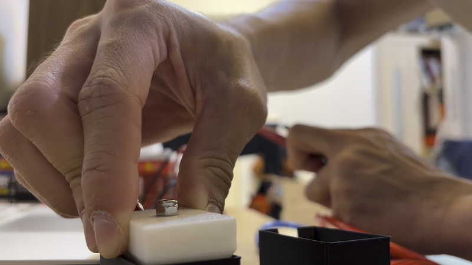
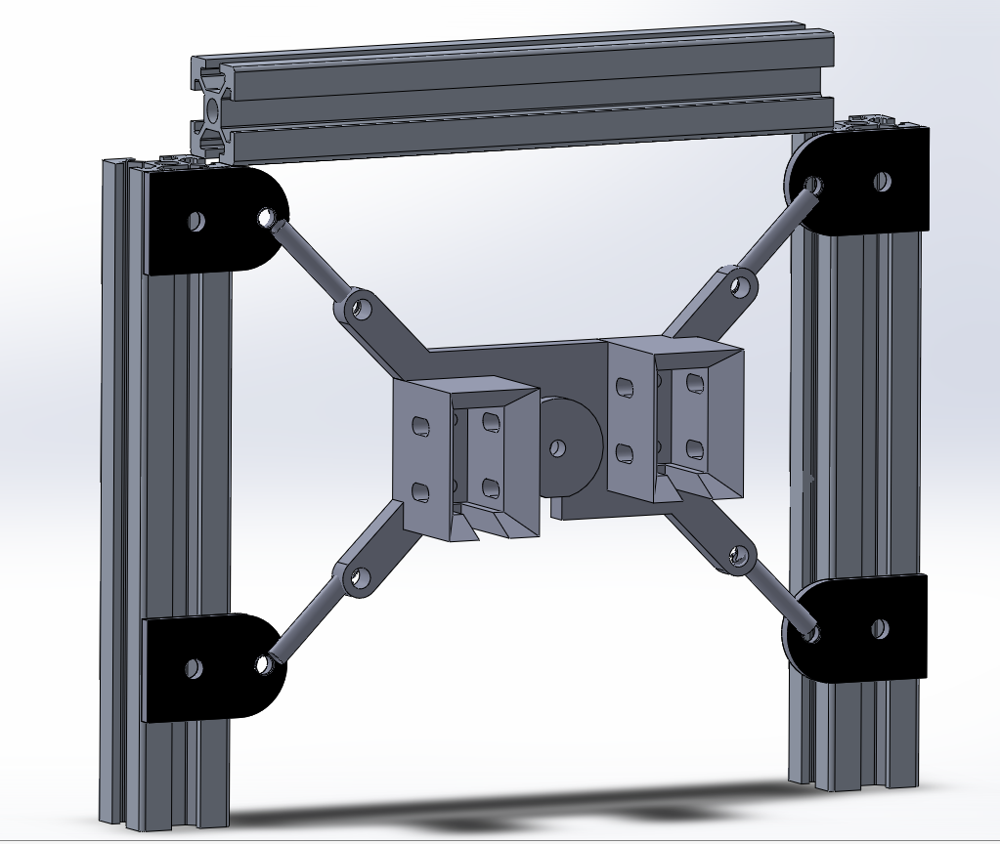
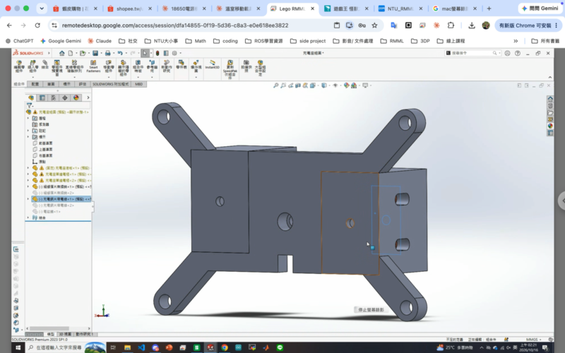

<!-- _class: title -->
<!-- _footer: "Tzu-Yu Dai is with Biomechatronics Engineering, National Taiwan University, Taipei, Taiwan [b12611017@ntu.edu.tw](mailto:b12611017@ntu.edu.tw) Ping-Lang Yen is with Biomechatronics Engineering, National Taiwan University, Taipei, Taiwan [plyen@ntu.edu.tw](mailto:plyen@ntu.edu.tw)" -->

# THR Charging Station Design

## 進度報告：v1 實測與 v2 浮動座設計

Presenter: Lego Dai
Advisor: Ping-Lang Yen Ph.D.
16th October, 2026
RMML Meeting

---

<!-- _class: outline -->

# Outline

- 前情提要：原訂五週時程與里程碑
- 上週進度回顧
- 問題
- 對策
- 下週計畫
- 與原時程比較

---

# 前情提要：五週時程，11/5 測試

###### 前情提要 · 原訂時程

<b>W1 10/1W2 10/8W3 10/15W4 10/22W5 10/29</b>
<i>尺寸修正＋v1 列印</i><s style="--a:0;--b:1"></s>
<i>實測：定位誤差、吸力</i><s class="o" style="--a:0.3;--b:1.3"></s>
<i>v1 手動對接測試</i><s class="o" style="--a:1;--b:2"></s>
<i>v2 設計（浮動 ±6 mm）</i><s style="--a:1.4;--b:2"></s>
<i>v2 列印＋組裝</i><s style="--a:2;--b:3"></s>
<i>電磁鐵／充電電路</i><s style="--a:2;--b:3.3"></s>
<i>手臂整合（定位→吸合）</i><s class="k" style="--a:3;--b:4"></s>
<i>重複對接＋溫升測試</i><s class="o" style="--a:4;--b:4.7"></s>
<i>Demo 準備＋錄影備案</i><s class="k" style="--a:4.3;--b:5"></s>

<b></b>機構設計／製作<b class="o"></b>量測／測試<b class="k"></b>系統整合／Demo　｜　里程碑 M1 10/7、M2 10/14、M3 10/21、M4 10/28、M5 11/4

---

# 前情提要：每週一個可驗收版本

###### 前情提要 · 原訂里程碑

| 里程碑 | 原訂 | 交付成果 | 驗收標準 |
|---|---|---|---|
| M1 | 10/7 | v1 充電頭／座列印完成 | 量到手臂 xyz 與姿態誤差、電磁鐵吸力是否足夠 |
| M2 | 10/14 | v2 設計定案 | v1 手推可順利導入；浮動座與彈簧規格確定 |
| M3 | 10/21 | v2 機構組裝完成 | 手推對接：吸合、導通、釋放皆正常 |
| M4 | 10/28 | 手臂自動對接首次成功 | 一鍵完成 定位 → 導入 → 吸合 → 導通 → 釋放 |
| M5 / Demo | 11/4、11/5 | 現場測試 | 連續 10 次至少 9 次成功；錄好備案影片 |

<small>本週（W3）原訂進入 v2 列印組裝與電磁鐵電路；以下報告實際進度與差異。</small>

---

# v1 完成：捕捉範圍實測 4.2 mm

###### 上週進度 · v1

- v1 站端（斜面導入座＋彈簧預壓銅片座）、車端充電頭*列印完成並組裝*
- 捕捉範圍實測 ***4.2 mm***：插頭偏移 4.2 mm 以內都能被斜面導入
  - 但比假設的手臂誤差 ±5 mm 小，**需實測手臂誤差確認**
- 預壓彈簧行程 3 mm（20 mm 彈簧）
- 銅片座以 4 根螺絲＋長槽導向，保留微小擺動讓銅片自己貼平

<small>影片：銅片貼合，三用電表導通</small>

---

<!-- _class: dense -->

# v2 浮動座 CAD 完成：X／Y ±6 mm

###### 上週進度 · v2

- 浮動機構：充電座以 4 條 45° 斜拉彈簧吊在 200 mm 鋁擠框中，平面內 X／Y 浮動 ***±6 mm*** 並自動回中
- 前後限位：後擋板＋前蓋板夾住前後方向，避免翹起
- 最大偏移限位：電磁鐵背面螺絲延長當限位銷；後擋板開 ∅（銷徑＋12 mm）的孔 → 最大偏移 6 mm
- 吸附面：改用 3–5 mm 厚扁鐵；薄引磁片會*磁飽和、吸力不足*

---

# 問題：改版與缺料，整組尚未測試

###### 問題

- 設計改版（加入浮動座），**v2 零件來不及印出正確尺寸**
- 部分材料未到齊（拉簧、扁鐵等），尚無法完整組裝測試
- ***已驗證***：預壓設計讓兩片充電銅片貼合，三用電表導通（p.5 影片）
- *未驗證*：
  - 電磁鐵吸力（含 0.5 mm 間隙）
  - 手臂實際定位誤差
  - 接觸電阻、整組對接

<small>影片：v2 新設計</small>

---

# 對策：先量不需新零件的項目

###### 對策 · 手臂定位誤差

材料到齊前，先量手臂定位誤差：

1. 教一個完美對接姿態
2. 視覺定位 20 次
3. 記錄 TCP 座標差
4. `e = 平均 + 3σ`

> ### *判斷*
> 用 `e` 和捕捉範圍 4.2 mm 比較；若 `e > 4.2 mm`，加長斜面或加大浮動行程。

---

<!-- _class: g2 -->

# 對策：不用力量計的量化方法

###### 對策 · 量化

- ### 彈簧剛性
  廚房秤＋游標卡尺，畫 F–δ 曲線
- ### 電磁鐵吸力
  鐵片吊水瓶加水至脫落；夾 5 張影印紙（≈0.5 mm）比較有無間隙，目標 ***≥ 30 N***
- ### 接觸電阻
  電源供應器定電流 2–5 A，量銅片間 mV 壓降，目標 ***R < 0.2 mΩ***（25 A 時壓降 < 5 mV）
- ### *避免重印*
  v2 零件先印小試片確認間隙（0.3 mm）再印整件

---

# 下週計畫（10/16–10/23）

###### 下週計畫

- ### 量測
  #### 約 4 h
  手臂定位誤差 `e`、電磁鐵吸力
- ### v2 製作
  #### 約 6 h
  浮動座列印＋組裝（材料到齊後）
- ### *手推整組對接*
  #### 約 4 h
  導入 → 吸合 → 導通 → 斷電釋放，量接觸電阻

---

<!-- _class: dense -->

# 與原時程比較：實測落後約 1 週

###### 與原時程比較

| 里程碑 | 原訂 | 內容 | 狀態 |
|---|---|---|---|
| M1 | 10/7 | v1 列印；量手臂誤差、吸力曲線 | *部分完成*：v1 列印、捕捉範圍 4.2 mm 已完成；手臂誤差、吸力未量 |
| M2 | 10/14 | v2 設計定案、浮動座與彈簧規格 | ***大致完成***：v2 CAD 與彈簧規格已定，尚未列印 |
| M3 | 10/21 | v2 組裝、手推對接成功 | **有風險**：材料未齊，預計延後約 3–4 天 |
| M4 | 10/28 | 手臂自動對接首次成功 | *可能延後*：依 M3 進度 |
| M5 / Demo | 11/4、11/5 | 連續 10 次至少 9 次成功 | ***維持***：若 M3 延後，壓縮 M4–M5 的重複測試時間 |

> ### *結論*
> 設計進度超前（多了浮動座），實測進度落後約 1 週，主要卡在**材料和列印**。
