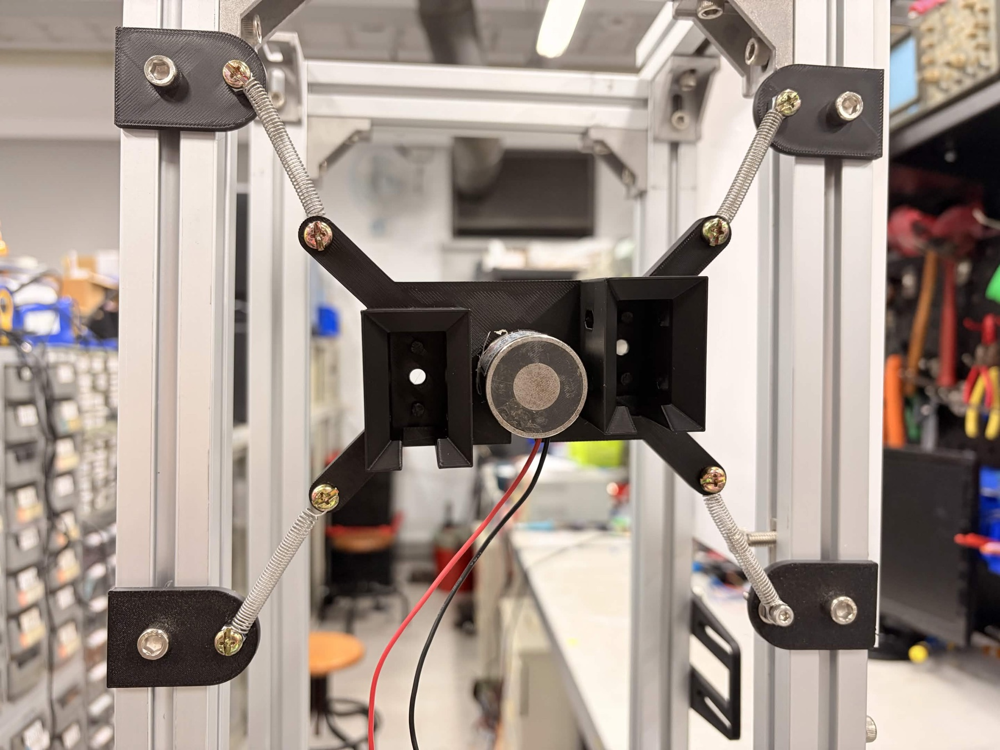
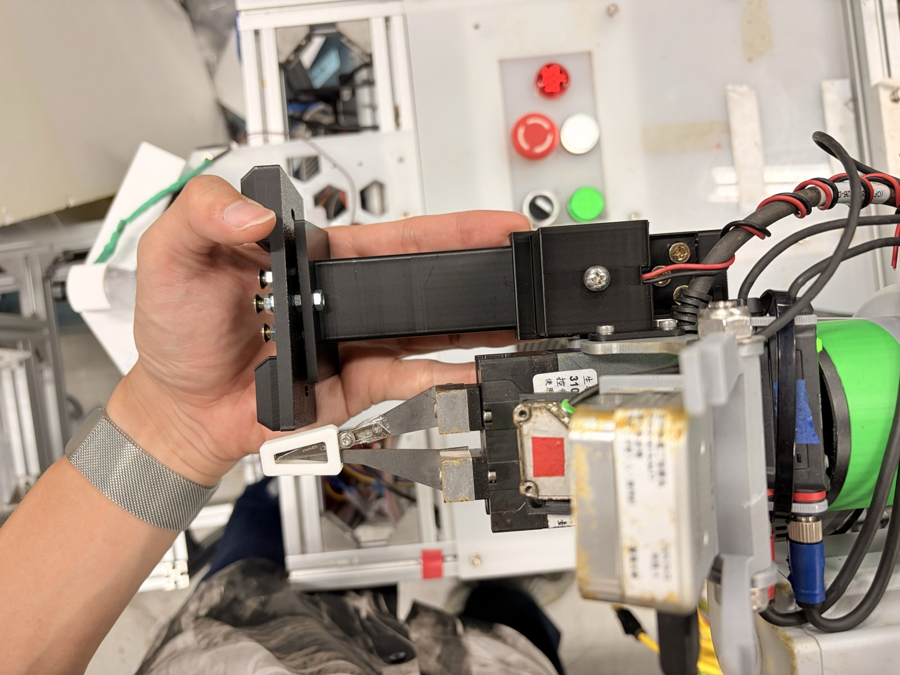

<!-- _class: title -->
<!-- _footer: "Tzu-Yu Dai is with Biomechatronics Engineering, National Taiwan University, Taipei, Taiwan [b12611017@ntu.edu.tw](mailto:b12611017@ntu.edu.tw) Ping-Lang Yen is with Biomechatronics Engineering, National Taiwan University, Taipei, Taiwan [plyen@ntu.edu.tw](mailto:plyen@ntu.edu.tw)" -->

# THR Charging Station Design

## 進度報告：浮動座組裝與對接流程驗證

Presenter: Lego Dai
Advisor: Ping-Lang Yen Ph.D.
30th October, 2026
RMML Meeting

---

<!-- _class: outline -->

# Outline

- 前情提要：系統架構
- 本週進度
- 問題與量測方法
- 下週計畫
- 與原時程比較

---

<!-- _class: g3 -->

# 前情提要：充電站、充電頭、控制

###### 前情提要 · 系統架構

- ### 充電站
  充電座以 4 條 45° 斜拉彈簧吊在 200 mm 鋁擠框，平面 ***±6 mm*** 浮動、自動回中；30° 斜面口袋導入，銅片彈簧預壓（行程 3 mm）
- ### 充電頭（可拆）
  平常放在車上的收納座；手臂用朝下的自保型電磁鐵吸起，手臂端導引槽讓充電頭每次都對正
- ### 控制
  充電站電磁鐵 XDA-30/25D（24 V、15 kg、斷電吸住、通電放開）：L298N＋樹莓派；手臂端電磁鐵：規劃用 TM 控制箱 DO＋繼電器

---

# 浮動座 10/22 完成組裝

###### 本週進度 · 充電站

- 4 條 45° 斜拉彈簧裝上 200 mm 鋁擠框
- 充電座停在框中央，平面 ±6 mm 浮動、自動回中
- 中央為 XDA-30/25D 電磁鐵，兩側為 30° 斜面口袋
- 組好後，手推與手動移動手臂都能吸合、拔出（p.7–9 影片）

<small>浮動充電座（10/22）</small>

---

# 對接方式改版：充電頭可拆、由手臂取放

###### 本週進度 · 對接方式

- 充電頭改成***可拆***，平放在車上的收納座
- 手臂從上方用電磁鐵吸取；手臂端加***導引槽***，吸起後充電頭始終正對充電站

1. 車上收納座
2. 手臂吸起充電頭
3. 帶到充電站
4. 吸上充電座充電
5. 拔下、放回車上

---

# 吸附目標：304 不導磁，改鐵螺絲

###### 本週進度 · 吸附材料

- 一般不鏽鋼（304）*不導磁*，電磁鐵吸不住
- 改用***鐵螺絲***當吸附目標
- 合適尺寸的鐵片還沒買到 → 先在現有列印件上鑽孔、裝鐵螺絲緊急測試
- 結果：吸附和密合程度***可以接受***
- 正式版改用鋼板（見 p.10）

<small>充電頭：列印件＋鐵螺絲（IMG_3157）</small>

---

# 影片 1：手臂從車上吸起充電頭

###### 本週進度 · 流程驗證 1／3

<video src="media/IMG_3153.mp4" poster="img/video1-IMG_3153.jpg" controls style="height:420px;width:747px;display:block;margin:0 auto"></video>

<small>充電頭放在車上，手動移動手臂把它吸起來。｜影片檔：`IMG_3153.mov`</small>

---

# 影片 2：把充電頭吸到充電座上

###### 本週進度 · 流程驗證 2／3

<video src="media/IMG_3154.mp4" poster="img/video2-IMG_3154.jpg" controls style="height:420px;width:747px;display:block;margin:0 auto"></video>

<small>把充電頭帶到充電站，吸到浮動充電座上。｜影片檔：`IMG_3154.MOV`</small>

---

# 影片 3：從充電座拔下充電頭

###### 本週進度 · 流程驗證 3／3

<video src="media/IMG_3156.mp4" poster="img/video3-IMG_3156.jpg" controls style="height:420px;width:747px;display:block;margin:0 auto"></video>

<small>手臂把充電頭從充電座拔下來。｜影片檔：`IMG_3156.MOV`</small>

---

# 問題：吸附面積小、流程仍是手動

###### 問題

- 吸附目標是「列印件＋鐵螺絲」，面積小，**吸力只是暫時夠用**
  - 正式版：30×30×4 mm 低碳鋼板，或兩片 ϕ30 鐵製加大華司＋M6 碳鋼平頭螺絲
  - 需求量小，正在請同事、學長介紹可小量切鋼板的廠商
- 三段影片都是***手動移動手臂***，**還沒寫成自動流程**
- 關鍵數據都還沒量（見下頁）

---

# 問題：關鍵數據尚未量測

###### 問題 · 未測項目

| 項目 | 方法 | 目標 | 狀態 |
|---|---|---|---|
| 電磁鐵吸力（0.5 mm 間隙） | 水瓶法（p.12） | ≥ 30 N | *未測* |
| 接觸電阻 | 四線壓降法，2–5 A（p.13） | < 0.2 mΩ | *未測* |
| 手臂定位誤差 `e` | 筆尖打點 20 次（p.14） | ≤ 捕捉範圍 | *未測* |
| 連續對接成功率 | 連續對接 10 次 | ≥ 9／10 | *未測* |

<small>目標值沿用 10/16 報告；以下三頁說明目標怎麼定、具體怎麼量。</small>

---

<!-- _class: dense -->

# 吸力：水瓶法，目標 ≥ 30 N

###### 量測方法 · 1／3 吸力

- 電磁鐵吸附面朝下固定，吸上吸附目標，下方用繩子吊一個空水瓶（4–5 L）
- 目標與電磁鐵之間夾 5 張影印紙（≈ 0.5 mm），模擬實際對接間隙；另量一組 0 mm 對照
- 慢慢加水直到脫落，秤「水瓶＋水＋吸附目標」總重 `m`，`F = m·g`
- 每組重複 3 次取*最小值*；比較鐵螺絲件與正式鋼板
- 通電 24 V，確認能完全放開

> ### *目標怎麼定*
> `F 需求 = SF ×（銅片預壓反力＋充電頭重＋線材拉力）`
> 額定 15 kg（≈ 147 N）是 0 間隙、厚鐵片的理想值；有間隙、面積小時會大幅下降。
> 30 N（≈ 3 kg 水）是 10/16 的暫定值，量到預壓反力與充電頭重量後再回推確認。

---

<!-- _class: dense -->

# 接觸電阻：四線壓降法，目標 < 0.2 mΩ

###### 量測方法 · 2／3 接觸電阻

- 對接吸合後，電源供應器設定電流，電流從兩端導線流過接點
- 電表探棒直接點在兩片銅片上、緊靠接觸面（*四線法*：量電壓的線不走電流，排除導線電阻）
- 依序打 2、3、4、5 A 記錄 mV，畫 V–I 取斜率 `R = ΔV / ΔI`
- 正負極對調各量一次取平均，抵消熱電勢
- 拔插 10 次、每次都量，看重複性

> ### *目標怎麼定*
> 以充電電流 25 A 估算：`P = I²R`
> 0.2 mΩ → 壓降 5 mV、每個接點發熱約 0.125 W，溫升可忽略。
> 5 A 時壓降只有約 1 mV，電表要用 mV 檔、解析度 ≤ 0.1 mV。

---

<!-- _class: dense -->

# 定位誤差 e：打點 20 次，e ≤ 捕捉範圍

###### 量測方法 · 3／3 定位誤差

- 示教一個「完美對接」姿態 `P0`：充電頭正對口袋中心
- 充電頭中心裝一支筆尖，充電站口袋前貼方格紙
- 手臂從待機點出發，停在 `P0` 前方輕點紙面；重複 20 次（若 Demo 時車會移動，每次都把車開走再停回）
- 游標卡尺量每點到中心的距離 `dᵢ`，`e = 平均(d) + 3σ`

> ### *目標怎麼定*
> `3σ` 涵蓋約 99.7% 的情況；`e` ≤ 捕捉範圍 → 幾乎每次都能被斜面導入。
> 4.2 mm 是 v1（無浮動）實測值；v2 多了 ±6 mm 浮動，捕捉範圍要*重新量*。
> 若 `e` > 捕捉範圍：加長斜面或加大浮動行程。

---

<!-- _class: g2 -->

# 下週計畫（10/30–11/5）：先導電，再自動化

###### 下週計畫

- ### 1. 導電測試（先做）
  電源供應器 2–5 A，四線法量接觸壓降，算接觸電阻
- ### 2. 手臂自動化
  TMflow 設定充電頭 TCP；把 取頭 → 對接 → 放手 → 拔出 → 放回 寫成一個流程，搭配兩顆電磁鐵的開關時序
- ### 3. 正式鋼板＋吸力
  請同事、學長介紹可小量切鋼板的廠商；裝上充電頭後用水瓶法量吸力
- ### *4. 連續對接＋備案影片*
  連續對接 10 次記錄成功率，並錄好 Demo 備案影片

---

<!-- _class: dense -->

# 與原時程比較：機構走通，自動化落後

###### 與原時程比較

| 里程碑 | 原訂 | 內容 | 狀態 |
|---|---|---|---|
| M3 | 10/21 | v2 組裝、手推對接成功 | ***大致完成***：浮動座 10/22 組好；手推和手動移動手臂都能吸合、拔出 |
| M4 | 10/28 | 手臂自動對接首次成功 | *部分完成*：取頭、對接、拔出都已用手動移動手臂驗證過，尚未寫成自動流程 |
| M5 | 11/4 | 連續 10 次至少 9 次成功、錄好備案影片 | **有風險**：自動流程、吸力和電阻量測都還沒做，預計壓縮到 11/2–11/4 |
| Demo | 11/5 | 現場展示（同天 RMML 大咪） | ***目標不變***：若自動流程來不及，改展示半自動流程＋備案影片 |

> ### *結論*
> 機構這週已經走通完整動作，接下來的重點是**自動化和量化數據**。
