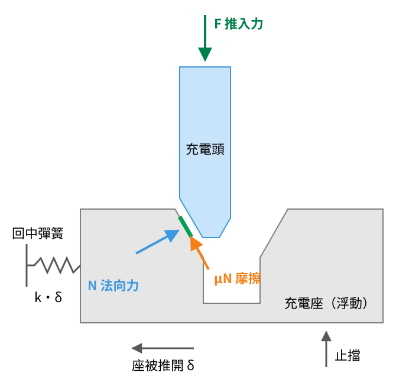

<!-- _class: title -->
<!-- _footer: "Tzu-Yu Dai is with Biomechatronics Engineering, National Taiwan University, Taipei, Taiwan [b12611017@ntu.edu.tw](mailto:b12611017@ntu.edu.tw) Ping-Lang Yen is with Biomechatronics Engineering, National Taiwan University, Taipei, Taiwan [plyen@ntu.edu.tw](mailto:plyen@ntu.edu.tw)" -->

# 簡報標題

## 副標題（可刪）

Presenter: Lego Dai
Advisor: Ping-Lang Yen Ph.D.
1st October, 2026
RMML Meeting

---

<!-- _class: outline -->

# Outline

- 第一部分
- 第二部分
- 未來計畫

---

# 一般內頁：條列 + 重點色

###### 小標（可刪）

- 一般文字；**紅色粗體重點**、*橘色重點*、***藍色重點***
- 第二點
  - 子項目
- 第三點

<small>註解小字放在最下面。</small>

---

# 卡片：每項以 ### 開頭就會橫排

- ### 01
  說明文字
- ### 02
  說明文字
- ### *03 強調卡*
  標題加 *星號* 變藍底

> ### 灰色虛線框（引用）
> - 用 `>` 開頭，適合「前版」「備案」「若…則…」

---

<!-- _class: g2 -->

# 數字卡 + 2 欄排列

- ### 現況
  #### **4.0 mm**
  計算依據
- ### 需求
  #### 6.5 mm
  計算依據
- ### *修改*
  #### 11.3 mm
  修改方式
- ### 備註
  `g2`／`g3` 讓卡片換行成 2／3 欄

---

# 流程 + 強調框

每個階段都走同樣五步：

1. 假設
2. 自由體圖
3. 幾何關係
4. 代入數字
5. 設計條件

> ### *本週下一步*
> 有序清單（1. 2. 3.）會變成橫向流程，最後一步為藍色。

---

# 兩欄：左圖右文

> 對充電頭列平衡
> 軸向 `F = N(sin α + μ cos α)`

> ### *公式強調*
> `F = k·δ · tan(α + φ)`

說明文字，可用 **重點**。

---

# 表格

| 項目 | 條件 | 目前 | 狀態 |
|---|---|---|---|
| C1 捕捉範圍 | 斜面高 × tan 30° ≥ 6.5 mm | 4.0 mm | **需修改** |
| C2 不卡死 | 倒角 α ≤ 53° | 30° | ***通過*** |
| C3 推入力 | ≤ 手臂盲推力 | 約 8 N | 待實測 |

---

# 甘特圖

<b>W1 10/1W2 10/8W3 10/15W4 10/22W5 10/29</b>
<i>設計與列印</i><s style="--a:0;--b:1"></s>
<i>量測</i><s class="o" style="--a:0.3;--b:1.3"></s>
<i>系統整合</i><s class="k" style="--a:3;--b:4"></s>
<i>Demo 準備</i><s class="k" style="--a:4.3;--b:5"></s>

<b></b>機構設計／製作<b class="o"></b>量測／測試<b class="k"></b>系統整合／Demo

---

<!-- _class: chapter -->

## Part II

# 章節標題

用一兩行說明這一段在講什麼

---

# 圖片頁

<small>圖片：`` 控制高度，`` 控制寬度</small>
